# 🖨️ SheetHappens

**SheetHappens** is a containerized, multi-printer web print server built with **Go** and **CUPS** for **Ubuntu Server (x86_64)**, designed to be exposed securely to the internet through **Cloudflare Tunnels** and **Cloudflare Zero Trust Access**.

While pre-tuned with first-class **HPLIP / `hpcups`** drivers for the **HP DeskJet Ink Advantage 2375** connected via USB, SheetHappens is **100% printer-agnostic**: any USB or network printer registered in CUPS automatically appears in the bilingual (**EN / ES**) web portal with controls for copies, color/grayscale, custom page ranges, duplex, and orientation.

---

## 🏗️ Architecture

```mermaid
flowchart LR
    User["Browser (EN / ES UI)"] -->|HTTPS + Zero Trust| CF["Cloudflare Edge"]
    CF -->|Encrypted Tunnel| Cloudflared["cloudflared container"]
    Cloudflared -->|http://print-api:8080| API["Go print-api container"]
    API -->|IPP / lp & lpstat :631| CUPS["CUPS container (HPLIP + Gutenprint)"]
    CUPS -->|/dev/bus/usb passthrough| Printer["USB / Network Printers\n(HP DeskJet 2375, etc.)"]
```



All containers communicate over an isolated Docker bridge network (`sheet_net`):
- **`cups` (`sheethappens-cups`)**: Debian Bookworm container with `cups`, `hplip`, `printer-driver-hpcups`, `printer-driver-gutenprint`, `printer-driver-brlaser`, `printer-driver-foo2zjs`, `foomatic-db-compressed-ppds`, and `openprinting-ppds`. Exposes port `631` on the local LAN for initial printer administration.
- **`print-api` (`sheethappens-print-api`)**: Statically compiled Go 1.22+ server running as non-root `appuser` on Alpine Linux. Validates file magic bytes (`application/pdf`, `image/png`, `image/jpeg`, `text/plain`), enforces `MAX_UPLOAD_MB`, spools files to `/tmp/sheethappens-<UUID>.<ext>` with guaranteed `defer os.Remove()` cleanup, and serves the bilingual web portal.
- **`cloudflared` (`sheethappens-cloudflared`)**: Connects `print-api:8080` to your Cloudflare Tunnel without opening inbound router ports.

---

## 🚀 Quick Start (Cold Boot on Ubuntu Server)

### 1. Prerequisites
- Ubuntu Server 22.04 / 24.04 LTS (`x86_64`)
- Docker Engine & Docker Compose plugin (`docker compose version`)
- `usbutils` installed on the host (`sudo apt-get install -y usbutils`)

### 2. Verify USB Printer Connection on the Host
Connect your USB printer (e.g., **HP DeskJet Ink Advantage 2375**) and run the included diagnostic script:

```bash
chmod +x scripts/check-usb-printer.sh
./scripts/check-usb-printer.sh
```

Confirm that Vendor ID `03f0` (Hewlett-Packard) is listed by `lsusb`.

### 3. Configure Environment Variables
Copy the environment template and customize your credentials:

```bash
cp .env.example .env
nano .env
```

| Variable | Description | Example |
| :--- | :--- | :--- |
| `PORT` | HTTP listen port for `print-api` | `8080` |
| `CUPS_HOST` | Internal CUPS scheduler address | `cups:631` |
| `DEFAULT_PRINTER` | Fallback CUPS queue name (optional) | `HP_DeskJet_2300` |
| `MAX_UPLOAD_MB` | Maximum upload size in MB (`1–200`) | `20` |
| `CUPS_ADMIN_USER` | Admin username provisioned in CUPS (`lpadmin`) | `printadmin` |
| `CUPS_ADMIN_PASSWORD` | Admin password (minimum 8 characters) | `StrongPass!2026` |
| `CF_TUNNEL_TOKEN` | Cloudflare Tunnel connector token | `eyJhIjoi...` |

### 4. Build and Launch the Stack
```bash
docker compose up -d --build
```

Check container health:
```bash
docker compose ps
curl http://localhost:8080/api/health
```

---

## 🛠️ Onboarding the HP DeskJet Ink Advantage 2375 in CUPS

1. From a machine on your local network, open **`https://<HOST-IP>:631/admin`** in your browser.
   - Accept the self-signed TLS certificate warning presented by CUPS.
2. Click **Add Printer** and authenticate with the `CUPS_ADMIN_USER` and `CUPS_ADMIN_PASSWORD` defined in your `.env` file.
3. Under **Local Printers**, select your USB device:
   - `HP DeskJet 2300 series` (connected via `usb://HP/DeskJet%202300%20series?...`).
4. Set the **Name** (for example, `HP_DeskJet_2300` — no spaces), optional description, and leave **Sharing** unchecked (or checked if you also want LAN IPP printing). Click **Continue**.
5. Select the Make/Manufacturer **HP** and choose the driver:
   - **`HP DeskJet 2300 Series, hpcups`**
6. Click **Add Printer**, set default media size (e.g., `Letter` or `A4`), and click **Set Default Options**.
7. In the **Maintenance** dropdown on the printer page, optionally choose **Set As Server Default**.
8. Open the SheetHappens portal (`http://<HOST-IP>:8080`) and click **Refresh (↻)** — `HP_DeskJet_2300` will appear immediately in the **Target Printer** selector.

---

## 🔌 Onboarding Generic Third-Party Printers

Because the `cups` image ships with multi-vendor PPD collections, you can register almost any USB or network printer (IPP, AppSocket/JetDirect `socket://`, LPD) through **`https://<HOST-IP>:631/admin`**:

1. **Pre-installed Driver Bundles**:
   - **Epson / Canon / Sony / Citizen**: Choose **Gutenprint** (`printer-driver-gutenprint`).
   - **Brother monochrome lasers**: Choose **brlaser** (`printer-driver-brlaser`).
   - **HP LaserJet / Minolta / Samsung ZjStream**: Choose **foo2zjs** (`printer-driver-foo2zjs`).
   - **Generic PostScript / PCL / PDF**: Choose from **Foomatic** or **OpenPrinting PPDs**.
2. **Custom Vendor `.ppd` File**:
   - On the driver selection screen in CUPS, use **Or Provide a PPD File** to upload your manufacturer's `.ppd` file directly.
   - All registered queues and `.ppd` definitions are persisted inside the `sheethappens_cups_data` Docker volume (`/etc/cups`).

---

## 🔒 Securing Access with Cloudflare Tunnel & Zero Trust

Never expose port `631` to the public internet. Instead, expose only `print-api` through Cloudflare Tunnels with an Access policy:

### 1. Create the Cloudflare Tunnel
1. Go to **Cloudflare Zero Trust Dashboard → Networks → Tunnels → Create a tunnel**.
2. Select **Cloudflared**, name the tunnel `sheethappens`, and copy the **Tunnel Token** into `CF_TUNNEL_TOKEN` in your `.env`.
3. Add a **Public Hostname**:
   - **Subdomain / Domain**: e.g., `print.yourdomain.com`
   - **Service Type**: `HTTP`
   - **URL**: `print-api:8080`
4. Restart the tunnel container:
   ```bash
   docker compose up -d cloudflared
   ```

### 2. Protect the Portal with Cloudflare Access
1. Go to **Zero Trust → Access → Applications → Add an application → Self-hosted**.
2. Configure the application domain (`print.yourdomain.com`).
3. Create an **Allow** policy restricting access to your authorized email addresses (One-Time PIN) or identity provider (Google, GitHub).
4. Save the application. Visitors must now authenticate at Cloudflare's edge before reaching the **SheetHappens** web portal.

---

## 🔒 Security Highlights

- **Magic-Byte Inspection**: Uploaded files are validated using `http.DetectContentType` on the first 512 bytes. Only `application/pdf`, `image/png`, `image/jpeg`, and `text/plain` are accepted; spoofed extensions are rejected with `415 Unsupported Media Type`.
- **Zero Command Injection**: User-supplied filenames are discarded. Files are written to `/tmp/sheethappens-<UUID>.<ext>` (`0600`) and passed to `exec.CommandContext("lp", ...)` after `--` with strict regex/allow-list validation on every flag.
- **Guaranteed `/tmp` Cleanup**: Both `r.MultipartForm.RemoveAll()` and `defer os.Remove(spoolPath)` execute on every request path.
